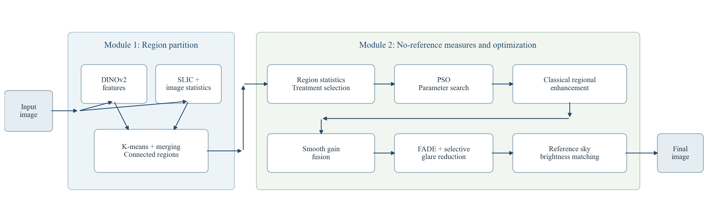
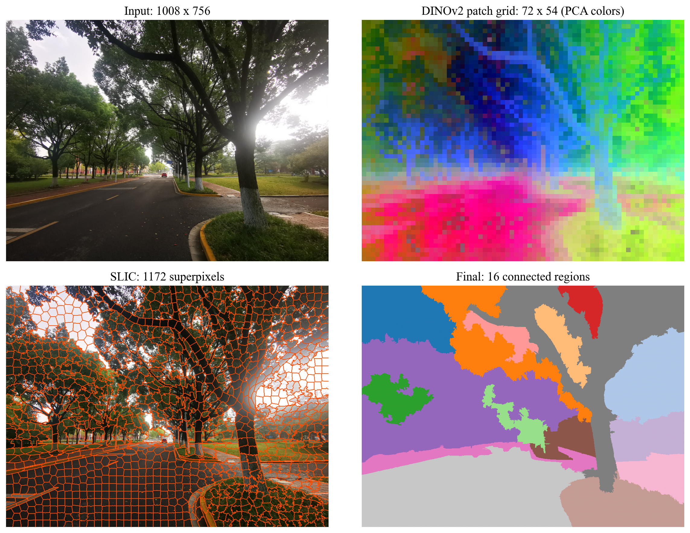
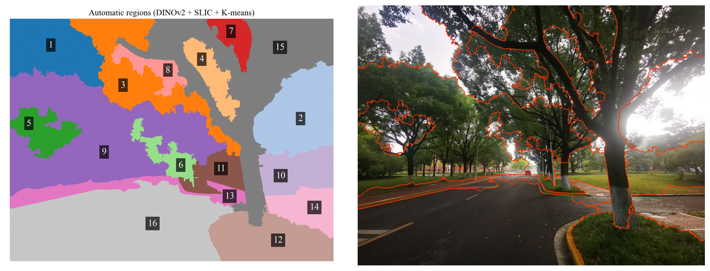
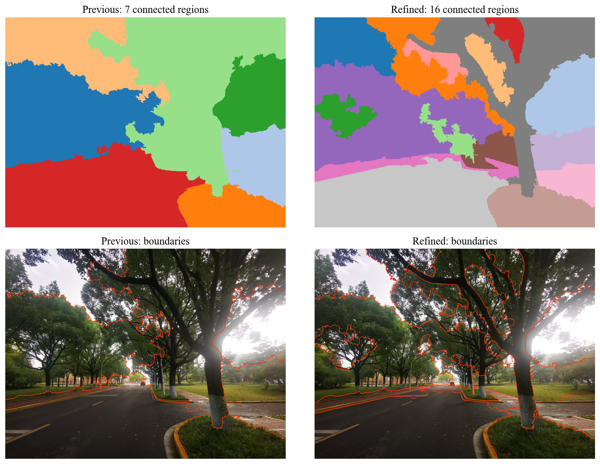
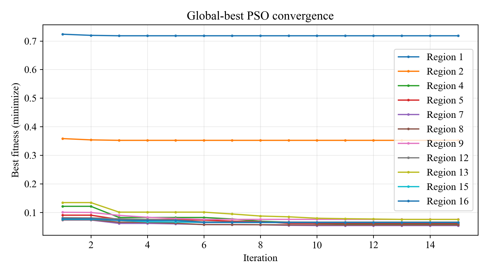
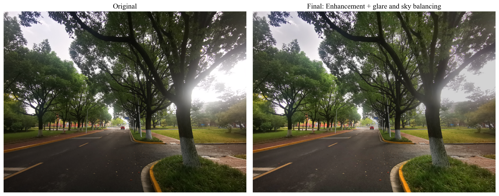
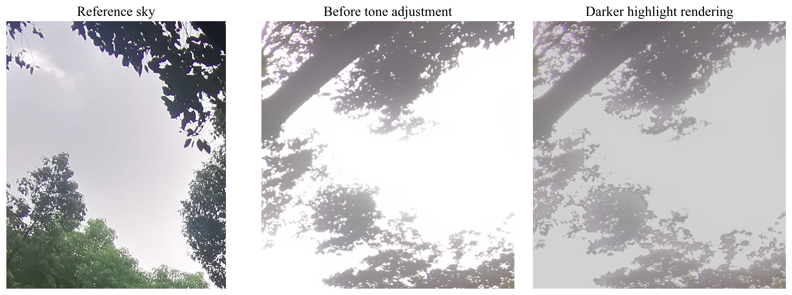

# 基于迁移学习的特征分析与自适应图像增强

## 1 引言

逆光图像常同时存在暗部亮度不足和高亮区域发白的问题。树冠与道路需要适度提亮，天空与光源附近则需要压缩亮度、减轻灰白光幕。对整幅图像使用相同的变换，难以兼顾这些不同需求；逐区域手工处理又依赖操作者对区域边界和参数的选择。

本实验将局部增强视为区域适应性与亮度协调的联合问题。其困难在于：同一幅图像中的暗部与高亮需要相反的亮度变换，局部指标的改善也可能造成区域间视觉失衡。

本文研究的问题是：在只有一张原始图像、缺少参考增强图像的条件下，如何自动确定局部处理范围，并根据图像自身的统计量选择增强参数，同时保持区域之间的亮度协调。为此，采用预训练图像特征辅助区域划分，以局部曝光等无参考指标构建目标函数，通过粒子群算法选择经典增强方法的参数，最后完成平滑融合与高亮亮度均衡。

## 2 方法

### 2.1 总体流程

方法由两个模块组成。区域划分模块结合图像内容与局部亮度特征，生成少量连通区域。无参考指标及其寻优模块根据各区域的统计特征选择处理方式，并优化增强参数；随后平滑亮度增益，处理残留光幕，并以可靠的天空区域为参考协调高亮亮度。

图1 方法流程。DINOv2仅提供冻结的局部特征，增强由经典算法完成。

### 2.2 模块一：从DINOv2局部特征到连通区域

**局部特征及其空间位置。** 冻结的DINOv2-small只负责提取表征[1]。原图按比例缩放至 $1008\times756$，不作中心裁剪；一般输入若不能被14整除，则在右侧和下侧反射填充。RGB用ImageNet均值 $(0.485,0.456,0.406)$ 和标准差 $(0.229,0.224,0.225)$ 归一化。最后一层输出形状为 $1\times3889\times384$，其中第一个向量是CLS token。去掉该向量，得到 $3888\times384$ 的局部特征矩阵 $F$。

模型按从左到右、从上到下的次序排列patch token。第 $q\times72+p$ 个局部向量对应第 $q$ 行、第 $p$ 列的14×14图像块，其中 $0\leq q<54$、$0\leq p<72$。因此，向量本身不是区域标签，但其排列保存了图像块的位置。对 $F$ 作PCA，保留16维，再恢复为空间网格：

$$
F\in\mathbb R^{3888\times384}
\xrightarrow{\mathrm{PCA}} F'\in\mathbb R^{3888\times16}
\xrightarrow{\mathrm{reshape}} D_0\in\mathbb R^{54\times72\times16}
\xrightarrow{\mathrm{bilinear}} D\in\mathbb R^{756\times1008\times16}.
$$

双线性插值使深度表征与分析图像逐像素对齐，其作用是建立对应关系，细小边缘信息仍主要来自原图。图2给出特征网格、超像素与最终区域之间的关系；特征图颜色为前三个PCA分量的显示值，不表示物体类别。

图2 原图、DINOv2特征网格、SLIC超像素及最终区域。

**由像素特征形成超像素描述。** 在RGB图像上使用SLIC生成约1400个超像素，紧致度为8，预平滑标准差为0.6[2]。超像素是局部连续的小块，其边界由图像颜色与空间距离共同确定。对每个超像素 $S_j$，计算深度表征的均值 $d_j$，以及4维低层特征均值 $l_j$：

$$
d_j=\frac{1}{|S_j|}\sum_{x\in S_j}D(x),\qquad
l_j=\frac{1}{|S_j|}\sum_{x\in S_j}[Y(x),\sigma_9(x),a(x),b(x)].
$$

其中，$Y=0.299R+0.587G+0.114B$，$\sigma_9$ 为9×9窗口内亮度标准差，$a,b$ 为Lab色度。深度特征提供较大范围的内容关联，低层特征补充局部亮度、对比度与颜色差异。两组分别按各维标准化，并按维数归一化后拼接：

$$
z_j=\left[\frac{\operatorname{Std}(d_j)}{\sqrt{16}},\frac{\operatorname{Std}(l_j)}{\sqrt4}\right]\in\mathbb R^{20}.
$$

这里 $\operatorname{Std}$ 表示对所有超像素的相应特征维作零均值、单位方差变换。如此避免16维深度特征仅因维数更多而占据过大权重。

**从特征类别形成空间区域。** 以超像素面积为权重，对 $z_j$ 进行K-means，初始类别数固定为5，初始化10次、随机种子42。每个超像素取得一个类别，并将该类别回填到其全部像素：$C(x)=c_j,\ x\in S_j$。同一类别可能同时出现在图像的多个位置，因此“5类”不等于“5个区域”。随后执行三步空间整理：

1. 对每类像素按四邻域拆分连通分量，为不相连的部分赋予独立编号。
2. 对面积超过全图25%的连通分量作一次局部二分类，使用其超像素描述 $z_j$，附加权重0.25的归一化超像素中心坐标。仍用面积加权K-means，二分类结果再次按四邻域拆分，以减少不同结构经窄连接带混成大区域的情况。
3. 当存在面积低于全图0.5%的区域，或区域总数超过16时，将当前最小区域并入描述均值距离最近的相邻区域，直至满足约束。只合并相邻区域，因此保留空间连通性。

最终标签通过最近邻插值映射回原图分辨率。区域编号不具有道路、天空等语义；报告中的内容名称仅用于事后说明。DINOv2也不直接判断退化类型。

原实现采用650个超像素、紧致度12、预平滑标准差1，并将区域限制在最多7个、最小面积2%。这些设置会消除较小的天空间隙与树冠内部差异。细化版本缩小超像素、减弱紧致度约束、降低小区域合并门槛，并允许大区域分裂，其目的是保留更多局部处理范围。这里的区域仍是增强所需的连续统计单元，不能等同于逐根树枝或逐片叶子的精确轮廓。

**处理需求判断。** 根据原图的区域统计，依次判断过暗、高亮、模糊、正常：平均亮度小于0.32且中位数小于0.30时判为过暗；平均亮度大于0.70，或亮度不低于0.85的像素超过30%时判为高亮；满足纹理要求且模糊度超过0.55时判为模糊，其余为正常。

模糊度采用 `skimage.measure.blur_effect`，`h_size=11`，方向取最大值。48×48评价块以步长24采样，要求区域覆盖率至少95%、亮度标准差至少0.025，且Sobel梯度大于0.04的像素至少占6%；至少3个有效块才进行模糊判断。光幕在第二模块中以连续权重进一步定位。

### 2.3 模块二：无参考指标及其寻优

**区域增强与目标函数。** 过暗区域采用Gamma校正与对比度受限自适应直方图均衡（CLAHE）。Gamma参数的搜索范围为 $[0.45,1.0]$，CLAHE裁剪参数的范围为 $[1,3]$，网格固定为 $8\times8$。借鉴局部曝光控制思想[3]，构建目标函数

$$
T_k=\bar Y_k^{(0)}+\min\{0.10,\;0.45(0.42-\bar Y_k^{(0)})_+\},
$$

$$
L_{\mathrm{dark}}
=\frac{1}{M}\sum_{k=1}^{M}|\bar Y_k-T_k|
+2P_{\mathrm{clip}}+0.20D_Y+0.05D_C+0.50P_{\mathrm{lift}}.
$$

其中，$\bar Y_k^{(0)}$ 与 $\bar Y_k$ 分别为原始及增强后局部块的平均亮度，$T_k$ 随原始亮度确定，单块目标提升量至多为0.10。$P_{\mathrm{clip}}$ 为新增通道裁剪比例，$D_Y$ 为平均绝对亮度改变量；$D_C$ 惩罚纹理位置的局部标准差比偏离1超过0.25的部分，$P_{\mathrm{lift}}$ 惩罚像素亮度增量超过0.12的部分。局部曝光块大小为16×16，要求区域覆盖率至少50%，均值仅统计块内属于该区域的像素。纹理约束在原图局部标准差大于0.015的位置计算。上述权重均固定，PSO只选择增强算法参数。初始统一曝光目标0.55容易使左侧树冠过亮，因此最终改为随原始块亮度确定的目标，限制提升量并约束对比度改变。

高亮区域采用Gamma亮度压缩，参数范围为 $[1,2.5]$。依据曝光权重[4]构建

$$
W(Y)=\exp\!\left[-\frac{(Y-0.5)^2}{2\times0.2^2}\right],
\qquad
L_{\mathrm{bright}}=1-\overline{W}+2P_{\mathrm{dark}}+0.2P_{\mathrm{color}}.
$$

曝光项使用原图中亮度位于 $[0.70,0.98)$ 且通道未饱和的像素；$P_{\mathrm{dark}}$ 为低于0.35的亮度欠缺量均值，$P_{\mathrm{color}}$ 为归一化RGB色度的平均变化。有效高亮像素需同时满足最大RGB通道小于0.995，其数量至少为128且不低于区域面积的1%，否则跳过该区域的PSO并保持原样。较暗像素的压缩权重逐渐减小，以保留高亮区域内部的树干与树枝。

模糊分支使用Unsharp Mask，半径 $\sigma\in[0.5,2.0]$、强度 $a\in[0,1.5]$，目标为有效纹理块平均模糊度，加上权重为2的新增裁剪惩罚和权重为0.5的过锐化惩罚。过锐化项为亮度绝对改变量超过0.10的部分的均值。本图未触发该分支。

所有候选结果均通过亮度比值缩放RGB。暗部增量在原始亮度0.55至0.85间逐渐减弱；高亮压缩在同一区间逐渐增强，并在0.95至0.995间保护近饱和像素。渐变使用 $s(u)=3u^2-2u^3$，其中 $u$ 为区间内归一化并截断至 $[0,1]$ 的亮度。候选增益限制为 $[0.75,2]$。

**参数寻优与融合。** 采用全局最优粒子群算法[5]。每个粒子表示一组增强参数，根据对应区域的目标函数更新，最终取损失最小的参数。粒子数为12，迭代15次，随机种子为42，惯性权重为0.7，两个学习因子均为1.5。各区域独立寻优，图像特征只提取一次。PSO采用标准更新：

$$
v_i^{t+1}=0.7v_i^t+1.5r_1(p_i-x_i^t)+1.5r_2(g-x_i^t),\qquad x_i^{t+1}=x_i^t+v_i^{t+1}.
$$

其中 $p_i$ 为粒子历史最优位置，$g$ 为群体最优位置，$r_1,r_2$ 为独立均匀随机数。参数越界时采用反射处理，速度各维限制在 $[-0.2,0.2]$。每个区域重新设定种子42，初始化一个粒子为搜索区间中点，其余粒子均匀随机采样；暗部中点为 $(0.725,2.0)$，高亮中点为1.75。各目标均按最小化处理，评价掩码与纹理块由原图固定，整个优化过程中不变。

将各候选结果转换为相对原图的亮度增益，利用高斯平滑后的区域掩码进行加权融合，再以原图亮度引导增益场平滑[6]。具体而言，先取候选亮度增益的对数，区域掩码以标准差10的高斯核平滑并归一化加权；合成对数增益再以标准差8平滑，以原图亮度进行半径24、正则项0.01的引导滤波。以上空间参数以分析尺度像素计，随后将连续增益场映射回原分辨率，并再次进行亮度保护。平滑作用于增益场，原图纹理随连续增益保留到输出中。

**光幕处理与天空亮度协调。** 采用FADE评价局部雾感[7]，结合暗通道抬升、相对对比度下降和强光邻近程度，形成连续的光幕处理权重。对仍有纹理的候选位置采用暗通道恢复[8]：

$$
J(x)=\frac{I(x)-A}{\max(t(x),0.40)}+A.
$$

其中，$A$ 为自动估计的背景光，$t(x)$ 由15×15局部暗通道估计，并经引导滤波平滑，去雾强度设为0.95。恢复结果按光幕权重与输入混合，并限制过大的亮度下降。FADE使用原作者发布的两组统计模型，在8×8块上计算12项自然场景与色彩特征；本实验将其适配为Python实现，未进行模型训练。候选权重由多个平滑门函数相乘构成：FADE局部密度从0.4至1.2增强，暗通道值从0.04至0.18增强，局部变异系数从0.12至0.45衰减，局部标准差从0.008至0.035增强。强光邻近程度来自亮度0.85至0.98的响应经标准差70的高斯滤波，其权重在0.015至0.12间增加；亮度0.78至0.96间逐渐保护天空。权重经标准差5的高斯滤波及引导滤波平滑。阈值0.25仅用于统计候选面积，实际处理使用连续权重。

背景光取暗通道最高0.1%位置的颜色，再对其中最亮10%求均值，各通道限制在 $[0.65,1]$。透射率为 $t=1-0.95\min_{z\in\Omega(x),c} I_c(z)/A_c$，引导滤波半径为24、正则项为0.0025；恢复结果按 $0.95$ 倍候选权重混合，并将亮度下降限制在0.25以内。FADE用于候选定位和过程检查，该步骤采用固定参数。

最后，从高亮、低色差的连通区域中选取面积较大且饱和比例较低的区域作为参考。以参考亮度的25%分位值减去0.03确定目标 $T$，对较亮天空采用 $J_Y=a_iY^{1.5}$，其中 $a_i=T/\overline{Y_i^{1.5}}$。参考区域保持原样，其他区域的变换强度经空间平滑后逐渐作用于亮像素。候选天空要求亮度大于0.82、最大与最小RGB之差小于0.15，经5×5形态学开运算后保留面积至少为全图0.5%的连通部分。参考区域为饱和比例低于10%的最大候选区域；目标下限为0.65，仅处理平均亮度高于参考均值0.02的区域。尺度系数限制在 $[0.65,1]$，系数场与指数场分别以标准差18的高斯核及半径24、正则项0.01的引导滤波平滑，最终增益限制在 $[0.65,1]$，并在亮度0.65至0.85间逐渐启用。该变换进一步压低刺眼的白区，并拉伸未饱和高亮中的明暗变化。

上述处理将区域参数选择与空间亮度协调连接起来，得到原分辨率下的增强图像。

## 3 实验结果

实验图像为一幅 $5120\times3840$ 的逆光道路图像。程序运行于Windows环境，使用Python 3.12、PyTorch 2.5.1和RTX 3060 Laptop GPU。下文的整体统计量统一在 $1008\times756$ 尺度计算。

### 3.1 实验设置与过程

实验仅使用这一张输入图像，不设置参考增强图，也不计算PSNR或SSIM。最终版本展示自动分区和最终增强结果，不另设消融组。实际环境为Python 3.12.13、PyTorch 2.5.1+cu118、CUDA运行时11.8，显卡显存实测约6 GB。主要依赖为Transformers 4.46.3、NumPy 1.26.4、OpenCV 4.10.0.84、scikit-image 0.24.0、scikit-learn 1.5.2、SciPy 1.14.1、PySwarms 1.3.0和Matplotlib 3.9.2。

DINOv2权重固定为 `facebook/dinov2-small`，版本为 `ed25f3a31f01632728cabb09d1542f84ab7b0056`。GPU负责一次特征前向计算，分区统计、PSO和经典算法在CPU执行。实验先检查Python、CUDA及模型加载，再完成分区并保存特征与标签；随后按区域优化参数、回到原分辨率融合，最后处理光幕与天空亮度。

暗部目标函数由统一曝光目标调整为受限自适应目标，光幕与天空阶段沿用固定参数。在本次分区细化中，复用同一原图已缓存的3888个DINOv2局部特征，重新执行PCA、超像素划分与空间整理；随后对新分区中的全部有效退化区域重新运行PSO，并重建原分辨率融合图像。本次新增模型前向次数为0，优化区域数为11，未根据结果重复搜索PSO超参数。

本次分区计算耗时约2.19 s，区域PSO合计341.03 s，光幕及天空阶段约9.38 s。分区耗时不含此前的模型特征提取，PSO耗时不含绘图与图像保存。原图首次特征提取的已有记录约为4.97 s。

### 3.2 区域划分结果

细化后得到16个连通区域，其中过暗9个、高亮2个、正常5个。本图没有满足条件的模糊区域，未启用锐化。实际SLIC超像素数为1172，最小最终区域占全图1.54%。所有区域均通过四邻域连通检查。

图3 细化后的区域编号与边界叠加。

图4 原7区域划分与细化后的16区域划分。两幅标签图独立编号，颜色不表示相同语义。

细化结果保留了树冠内部较亮部分、树干附近背景与路侧窄带的独立边界，道路与上方树冠也被分开。部分阴影与植被仍混合在同一区域，细小枝叶没有逐一分离。区域数和边界数量增加只说明划分粒度改变；由于缺少人工标注，本实验不据此计算分割准确率。

表1 各区域在原图中的统计与主要需求。模糊度仅在原图有效纹理块上计算。

| 区域 | 面积占比 | 平均亮度 | 有效纹理块数 | 模糊度 | 主要需求 |
|---|---:|---:|---:|---:|---|
| 1 | 6.04% | 0.7031 | 40 | 0.2641 | 高亮 |
| 2 | 7.00% | 0.8203 | 50 | 0.3536 | 高亮 |
| 3 | 7.21% | 0.3970 | 31 | 0.2405 | 正常 |
| 4 | 2.23% | 0.2969 | 6 | 0.2395 | 过暗 |
| 5 | 2.46% | 0.3198 | 10 | 0.2562 | 过暗 |
| 6 | 1.72% | 0.4374 | 1 | — | 正常 |
| 7 | 1.54% | 0.1960 | 6 | 0.2060 | 过暗 |
| 8 | 1.58% | 0.2145 | 0 | — | 过暗 |
| 9 | 18.26% | 0.2284 | 115 | 0.2553 | 过暗 |
| 10 | 3.69% | 0.3896 | 27 | 0.2687 | 正常 |
| 11 | 2.22% | 0.3650 | 9 | 0.2512 | 正常 |
| 12 | 6.16% | 0.1485 | 32 | 0.2120 | 过暗 |
| 13 | 3.11% | 0.3120 | 3 | 0.3447 | 过暗 |
| 14 | 2.82% | 0.4116 | 19 | 0.2668 | 正常 |
| 15 | 16.09% | 0.2281 | 70 | 0.2427 | 过暗 |
| 16 | 17.88% | 0.1619 | 25 | 0.4463 | 过暗 |

### 3.3 最终优化结果

表2给出新分区对应的PSO参数；正常区域保持区域增强恒等变换，光幕与天空步骤另按各自权重处理。各行目标函数取决于区域类型，数值不用于不同区域之间的质量排序。

| 区域 | 算法 | Gamma | CLAHE裁剪参数 | 中点参数损失 | 最优损失 |
|---|---|---:|---:|---:|---:|
| 1 | Gamma压缩 | 2.4980 | — | 0.81553 | 0.71817 |
| 2 | Gamma压缩 | 2.4980 | — | 0.52138 | 0.35204 |
| 4 | Gamma + CLAHE | 0.9994 | 1.0604 | 0.21794 | 0.05780 |
| 5 | Gamma + CLAHE | 0.9733 | 1.0183 | 0.16709 | 0.06155 |
| 7 | Gamma + CLAHE | 0.8787 | 1.0042 | 0.14462 | 0.05375 |
| 8 | Gamma + CLAHE | 0.8932 | 1.0165 | 0.15635 | 0.05588 |
| 9 | Gamma + CLAHE | 0.9292 | 1.0113 | 0.18149 | 0.07538 |
| 12 | Gamma + CLAHE | 0.8510 | 1.0009 | 0.11709 | 0.06576 |
| 13 | Gamma + CLAHE | 0.9997 | 1.0449 | 0.26795 | 0.07512 |
| 15 | Gamma + CLAHE | 0.8082 | 1.0134 | 0.10508 | 0.06446 |
| 16 | Gamma + CLAHE | 0.7853 | 1.0145 | 0.12760 | 0.06434 |

图5 各有效退化区域的PSO历史最优损失。

图6 原图与细化分区后的最终增强结果。

表3 原图与最终结果的整体统计，均在1008×756尺度计算。局部对比度为9×9亮度标准差的均值，饱和阈值为0.995。纹理块由本次分区对应的原图固定选取，增强前后使用相同块；分区改变后，有效块数量会随之变化。

| 指标 | 原图 | 最终结果 |
|---|---:|---:|
| 平均亮度 | 0.31720 | 0.34320 |
| 平均局部对比度 | 0.06592 | 0.06739 |
| 亮度饱和像素比例 | 2.3804% | 0.1037% |
| 任一通道裁剪比例 | 2.7145% | 0.1656% |
| 纹理块模糊度（越低通常越清晰） | 0.27268 | 0.27456 |

有效纹理块共444个。曝光与局部对比度统计用于补充目标函数评价，不能单凭PSO损失下降判断最终图像更清晰。光幕候选面积占比为7.09%，其FADE局部密度均值由1.351降至1.162，局部变异系数由0.1424变为0.1638，梯度幅值比为0.8826。这些数值与模糊度一并保留，反映不同指标的变化。

图7 自动参考天空与右侧高亮天空的局部结果。

参考天空平均亮度为0.8854，目标亮度为0.8163。被压缩天空的平均亮度依次为0.9913→0.8177、0.9869→0.8169。

细化分区为局部参数选择提供了更多独立范围，但不意味着所有指标都会同步改善。树干附近仍有逆光光晕；右侧天空在原图中大面积近白，压暗后仍缺少云层纹理。当前方法完成了单图自动处理，其边界精度受分析尺度、DINOv2图像块尺寸及超像素合并过程共同限制。

## 参考文献

[1] OQUAB M, DARCET T, MOUTAKANNI T, et al. DINOv2: Learning robust visual features without supervision[EB/OL]. 2023. [https://arxiv.org/abs/2304.07193](https://arxiv.org/abs/2304.07193).

[2] ACHANTA R, SHAJI A, SMITH K, et al. SLIC superpixels compared to state-of-the-art superpixel methods[J]. IEEE Transactions on Pattern Analysis and Machine Intelligence, 2012, 34(11): 2274–2282. [https://doi.org/10.1109/TPAMI.2012.120](https://doi.org/10.1109/TPAMI.2012.120).

[3] GUO C, LI C, GUO J, et al. Zero-reference deep curve estimation for low-light image enhancement[C]//Proceedings of the IEEE/CVF Conference on Computer Vision and Pattern Recognition. 2020. [https://li-chongyi.github.io/Proj_Zero-DCE.html](https://li-chongyi.github.io/Proj_Zero-DCE.html).

[4] MERTENS T, KAUTZ J, VAN REETH F. Exposure fusion[C]//15th Pacific Conference on Computer Graphics and Applications. 2007: 382–390. [https://doi.org/10.1109/PG.2007.17](https://doi.org/10.1109/PG.2007.17).

[5] KENNEDY J, EBERHART R. Particle swarm optimization[C]//Proceedings of ICNN'95—International Conference on Neural Networks. 1995: 1942–1948. [https://doi.org/10.1109/ICNN.1995.488968](https://doi.org/10.1109/ICNN.1995.488968).

[6] HE K, SUN J, TANG X. Guided image filtering[J]. IEEE Transactions on Pattern Analysis and Machine Intelligence, 2013, 35(6): 1397–1409. [https://doi.org/10.1109/TPAMI.2012.213](https://doi.org/10.1109/TPAMI.2012.213).

[7] CHOI L K, YOU J, BOVIK A C. Referenceless prediction of perceptual fog density and perceptual image defogging[J]. IEEE Transactions on Image Processing, 2015, 24(11): 3888–3901. [https://doi.org/10.1109/TIP.2015.2456502](https://doi.org/10.1109/TIP.2015.2456502).

[8] HE K, SUN J, TANG X. Single image haze removal using dark channel prior[C]//Proceedings of the IEEE Conference on Computer Vision and Pattern Recognition. 2009: 1956–1963. [https://doi.org/10.1109/CVPR.2009.5206515](https://doi.org/10.1109/CVPR.2009.5206515).
